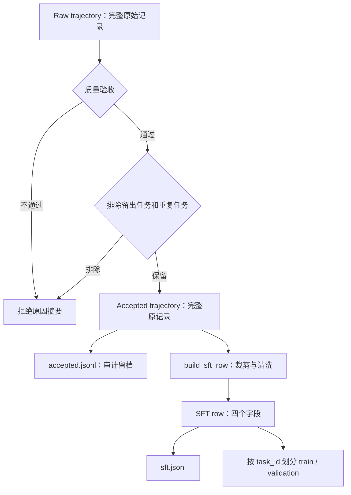

```markdown
# 004：SFT 轨迹验收与清洗

- 学习日期：2026-10-20
- 学习目标：理解原始轨迹如何经过验收、筛选和清洗，成为 SFT 数据。
- 主要代码：`src/shopping_grpo/collection/sft.py`
- 真实样本：`outputs/baseline-api/20261014_201133/trajectories.jsonl`
- 成功结构示例：`tests/test_sft_collection.py` 中的 `_accepted_trajectory()`，属于合成样例。
- 实践状态：已核对真实轨迹的拒绝原因与合成样例的转换结果，未生成正式训练集、未训练模型。

## 一、学习位置

项目链路：

任务输入 → Baseline → 环境交互 → 轨迹保存 → Reward/Summary  
→ **轨迹验收与清洗** → SFT 标签构造 → LoRA SFT → 评测  
→ RL 数据与奖励 → GRPO → 对比验证

这一阶段要回答两个问题：

1. 哪些轨迹值得模型模仿？
2. 通过验收后，哪些字段和消息应进入训练数据？

**验收决定能不能用，清洗决定保留什么。**

## 二、整体流程图



关键区别：

- **Raw trajectory**：完整运行记录，可能成功、失败、报错或未完成。
- **Accepted trajectory**：通过质量与数据范围筛选的原始轨迹，仍保留完整字段。
- **SFT row**：从 accepted trajectory 构造的训练记录，主要包含身份、消息和工具定义。

Accepted 并不是“已经清洗完的轨迹”。字段裁剪发生在 `build_sft_row()`。

## 三、关键函数与设计目的

| 函数 | 输入 → 输出 | 目的 |
|---|---|---|
| `acceptance_reasons()` | 原始轨迹 → 是否接受、拒绝原因列表 | 检查质量，不修改原轨迹 |
| `_tool_step_reject_reason()` | 轨迹、执行步骤 → 原因或 `None` | 检查工具参数、动作和页面一致性 |
| `_previous_observation()` | 轨迹、调用 ID → 之前的环境反馈 | 找到动作合法性的页面依据 |
| `build_collection_artifacts()` | 原始文件与配置 → 文件、统计 | 组织筛选、清洗、划分与审计 |
| `build_sft_row()` | 轨迹 → 四字段 SFT 行 | 构造训练结构，本身不验收 |
| `_training_messages()` | 消息和调用 ID → 清洗后的消息 | 删除拦截回合并清理字段 |
| `_terminal_tool_call_id()` | 轨迹 → 终局调用 ID | 定位应中性化的终局消息 |
| `_sanitize_message()` | 单条消息 → 清洗副本 | 白名单过滤与终局替换 |
| `_sanitize_tool_call()` | 工具调用 → 标准调用结构 | 移除供应商额外字段 |

## 四、第一关：质量验收

### 1. 函数入口

```python
accepted, reasons = acceptance_reasons(trajectory)
```

- `accepted`：布尔值。
- `reasons`：全部拒绝原因。
- 没有拒绝原因时返回 `(True, [])`。

### 2. 检查内容

| 层次 | 条件 | 原因 |
|---|---|---|
| 运行可靠性 | 无运行错误、无环境释放错误 | 避免基础设施异常数据 |
| 完整终局 | 轨迹与环境结束标记正确 | 避免未完成轨迹 |
| 购买动作 | 存在 `buy_now` 或 `click[Buy Now]` | 确认执行到购买 |
| 结果质量 | 有效 Reward v3、`gold_purchase`、购买成功 | 本配方只接受严格成功正例 |
| 调用协议 | assistant 每轮至多一个工具调用 | 保持串行执行协议 |
| 执行一致性 | 参数、工具名、环境动作和页面合法性一致 | 避免错误执行记录 |

### 3. 工具步骤如何检查

`_tool_step_reject_reason()` 检查：

1. 工具名是否存在。
2. 参数是否能解析成 JSON 对象。
3. 原始调用工具名是否等于 `step.tool_name`。
4. 参数转换出的动作是否等于 `step.env_action`。
5. 动作是否符合前一个环境页面。

`_previous_observation()` 会跳过 Guard 提示，寻找此前真实的工具反馈。

**Guard 错误提示不是商品页面，不能把它当作页面状态。**

### 4. 验收边界

`acceptance_reasons()`：

- 不重新运行环境。
- 不重新计算商品奖励。
- 不负责最终测试集隔离。
- 不负责任务去重。
- 不是对轨迹正确性的完整形式化证明。

测试集隔离与去重由外层处理。

## 五、任务 299 为什么被拒绝

实际调用结果：

```python
(
    False,
    [
        "reward_v3_not_gold_purchase",
        "purchase_not_successful",
        "termination_not_gold_purchase",
    ],
)
```

任务 299：

- 已执行购买。
- 环境正常结束。
- 奖励有效。
- 但类型为 `partial_alternative_purchase`，不是 `gold_purchase`。

因此它不符合本配方的严格成功正例要求。

**不能修改标签让失败轨迹通过。**它应保留作 Bad Case；若构造修正轨迹，需要重新执行并验证。

## 六、第二关：留出任务与去重

`build_collection_artifacts()` 在质量通过后继续检查：

1. 是否属于 `held_out_task_ids`。
2. 是否已经接受过同一个 `task_id`。

### 重要细节

- `held_out_task_ids` 由调用者传入，默认是空集合，不能认为函数自动知道所有测试任务。
- 同一任务保留文件顺序中第一个质量通过且未被排除的轨迹。
- 它不会自动选择最高奖励或最短轨迹。

通过后：

```python
accepted_trajectories.append(trajectory)
```

此时保留的是原始完整对象，尚未裁剪字段。

## 七、字段变化图

| Raw 字段 | Accepted trajectory | SFT row |
|---|---|---|
| `trajectory_id` | 保留 | 保留 |
| `task_id` | 保留 | 保留 |
| `messages` | 完整保留 | 清洗后的副本 |
| `steps` | 保留 | 不单独保留 |
| `blocked_tool_calls` | 保留 | 用于清洗，不单独保留 |
| `initial_result` | 保留 | 不单独保留 |
| `terminal_result` | 保留 | 不单独保留 |
| 奖励、状态、错误、时间等 | 原记录中有则保留 | 不保留为顶层字段 |
| `tools` | 不要求原轨迹存在 | 加入当前工具 schema 的深拷贝 |

SFT row 的顶层结构：

```json
{
  "trajectory_id": "轨迹标识",
  "task_id": 123,
  "messages": [],
  "tools": []
}
```

**SFT row 还不是 tensor。**下一阶段才会生成 `input_ids`、`attention_mask` 和 `labels`。

## 八、消息怎样清洗

### 1. 删除被拦截的调用回合

根据 `blocked_call_ids` 删除：

- 对应的 assistant 调用消息。
- 对应的 tool 反馈。
- 带 `runtime_action_guard` 标记的错误提示。

任务 299 的内存演示结果：

```text
原始 messages：22 条
转换后 messages：18 条
原始对象仍然：22 条
```

两次拦截，各删除一条 assistant 和一条 tool，共四条。

注意：这只是转换演示，没有将任务 299 写入训练集。

### 2. 字段白名单

消息只保留：

```text
role
content
tool_calls
tool_call_id
name
```

工具调用只保留：

```text
id
type
function
```

`function` 只保留：

```text
name
arguments
```

因此：

- `reasoning_content` 等额外字段被删除。
- 工具调用中的 `index` 等字段被删除。
- `tool_call_id` 保留，维持调用与反馈的对应关系。

边界：

**白名单仍保留 assistant.content，不会自动删除其中所有自然语言或敏感文本。**结构清洗不等于完整内容审查。

`arguments` 在此阶段仍可为 JSON 字符串，后续模板适配时再转换。

### 3. 中性化终局反馈

`_terminal_tool_call_id()` 定位终局调用，随后替换对应 tool 消息的内容：

```text
清洗前：Reward: 1.0; Gold purchase
清洗后：购买已完成。
```

目的：减少终局奖励、Gold 标签进入训练对话。

普通环境反馈仍保留，作为后续决策的上下文。

## 九、成功样例的演示

本地未找到可通过验收的真实成功原始 rollout。

演示使用：

```text
tests/test_sft_collection.py
中的 _accepted_trajectory()
```

它是合成 fixture，不能称为真实教师轨迹。

实际结果：

```text
验收：(True, [])
消息数量：10 → 10
reasoning_content：删除
终局奖励文本：替换为中性文本
tools：加入当前 13 项工具定义
```

没有被拦截的调用，因此消息数不变。

**清洗不一定减少消息数，也可能只修改字段与内容。**

## 十、为什么清洗？会损失什么？

| 操作 | 目的 | 代价或边界 |
|---|---|---|
| 删除非法调用 | 避免模仿错误动作 | 同时失去部分纠错行为 |
| 删除额外推理字段 | 统一训练协议 | 不代表完成全面内容审查 |
| 替换终局奖励文本 | 减少标签污染 | 仍需审查其他信息来源 |
| 保留工具反馈 | 为动作提供上下文 | 轨迹较长 |
| 保留调用 ID | 维持消息对应 | 删除时需要注意成对关系 |
| 保存完整原始轨迹 | 支持审计和重新构建 | 需要数据版本管理 |

思考：

“只学习正确动作”和“学习错误恢复”是不同目标。
当前配方偏向前者。若训练恢复能力，应设计新的数据方案，不能随意保留全部错误。

## 十一、输出文件与划分

```text
accepted.jsonl      通过筛选的完整轨迹
rejected.jsonl      身份、状态、拒绝原因摘要
sft.jsonl           清洗后的 SFT 行
train.jsonl         训练划分
validation.jsonl    验证划分
reject_stats.json  接受与拒绝统计
metadata.json      配置、行数和文件哈希
```

注意：

- 完整失败数据仍保留在 raw，`rejected.jsonl` 不是完整失败轨迹。
- 统计中的质量拒绝、留出排除、重复排除分别计数。
- 按 `task_id` 划分，避免同一任务跨训练和验证。
- 只有一个任务时，验证集可能为空。
- 哈希帮助复现，不证明数据质量正确。

## 十二、重点思考

### 为什么 build_sft_row 成功返回，样本仍可能不能训练？

它不执行验收，只负责结构转换。
正式流程必须先筛选，再转换。

### 为什么质量通过后仍要排除测试任务？

质量正确与数据泄漏是两个不同问题。
正确答案进入训练也会污染测试。

### 为什么保留 accepted 完整轨迹？

便于审计、定位清洗错误，以及未来更换规则后重新生成 SFT 数据。

### 为什么不直接使用部分满足轨迹？

当前目标是模仿严格成功行为。
部分满足轨迹可用于错误分析或修正轨迹构建，但不能直接冒充成功正例。

## 十三、自测任务

- 画出 raw → accepted → SFT row 的字段变化。
- 解释任务 299 的三个拒绝原因。
- 解释两次拦截为什么减少四条消息。
- 找出保留 tool_call_id 的必要性。
- 区分质量验收、测试集隔离和训练标签构造。

## 十四、下一步

阅读 `src/shopping_grpo/training/sft/dataset.py` 中的：

1. `normalize_messages_for_chat_template()`
2. `build_supervised_example()`
3. `load_supervised_examples()`

下一次画图：

完整消息
→ chat template
→ input_ids
→ assistant 监督区间
→ labels 与 IGNORE_INDEX=-100

重点问题：

工具 observation 不参与 loss，为什么仍然影响模型预测？
```