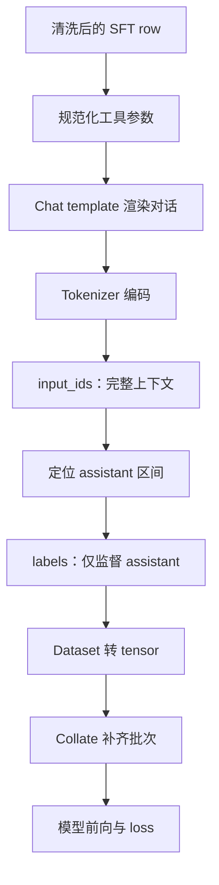

**005：SFT 模板渲染与标签构造**

- 学习日期：2026-10-20。
- 代码入口：[dataset.py](D:/AgentProjects/shopping-grpo-longhorizon/src/shopping_grpo/training/sft/dataset.py:56)。
- 已完成：阅读实现，实际检查工具参数规范化。
- 未完成：真实模型 tokenizer 编码与训练。当前 `.venv-cpu` 没有 Transformers、PyTorch 或模型 tokenizer。

**1．先把上一节与这一节连接起来**



上一节决定“哪些行为值得模仿”，这一节决定“用什么格式、在哪些位置监督”。

**2．第一步：工具参数适配模板**

`normalize_messages_for_chat_template(messages)` 深拷贝消息，把工具参数中的 JSON 字符串解析成字典。

任务 65 的实际检查结果：

```text
消息数：24
assistant 回合数：11
工具定义数：13

转换前，类型 str：
'{"query": "水彩笔 24色 三角杆 儿童"}'

转换后，类型 dict：
{"query": "水彩笔 24色 三角杆 儿童"}

原始消息仍保持 str，没有被修改。
```

这是为了适配模型模板对参数结构的要求。非法 JSON，或解析后不是字典，会导致样本被拒绝。

**思考：为什么深拷贝？**

原始 JSONL 需要保留标准接口格式和可追溯性；训练模板需要另一种内存结构。转换不应污染原数据。

**3．第二步：模板渲染与 tokenizer 编码**

两者分工不同：

| 组件 | 负责什么 |
|---|---|
| Chat template | 将角色、内容、工具定义和工具调用组织成模型规定的格式 |
| Tokenizer | 将渲染后的文本转成 token ID |

示意过程：

```text
messages + tools
→ 带角色和调用边界的文本
→ [token_1, token_2, token_3, ...]
```

真实边界标记取决于目标模型，不能手工假设所有模型都相同。

项目中的 `_token_ids()` 使用：

```python
tokenizer(text, add_special_tokens=False)
```

原因是前面的 chat template 已负责生成所需格式，避免重复添加特殊 token。

Qwen3.5 的模板由 processor 提供，编码使用其 tokenizer。**当前数据仍主要是文本工具调用，使用 processor 不代表已经接通图像训练。**

**4．第三步：区分三个训练数组**

| 数组 | 含义 |
|---|---|
| `input_ids` | 完整对话的 token ID |
| `attention_mask` | 哪些位置是有效内容，哪些是 padding |
| `labels` | 哪些 token 是训练目标 |

用消息区段表示：

```text
区段：           system   user   assistant   tool   assistant
attention_mask：   1       1        1         1        1
labels：         -100    -100    目标token   -100    目标token
```

这里是示意，不是真实模型 token 编码。

`IGNORE_INDEX=-100` 表示该位置不直接计算监督损失。**它不删除输入，也不阻止模型读取这段内容。**

例如模型需要读取商品列表，才能学会打开其中一个商品：

```text
tool：商品 A、商品 B、商品 C
assistant：open_product(B)
```

训练不要求模型复述商品列表，但商品列表仍参与下一步预测，相关计算也可能受到梯度影响。

另一个区别：`attention_mask` 标识有效位置；防止模型偷看未来答案的是模型使用的 **causal mask**，两者不是同一件事。

**5．核心函数：`build_supervised_example()`**

输入：

```python
messages
tools
tokenizer
max_length
chat_template  # 可选
```

输出：

```python
{
    "input_ids": [...],
    "attention_mask": [...],
    "labels": [...],
}
```

无法安全编码时返回 `None`。

它的步骤是：

1. 规范化消息，找出所有 assistant 消息的位置。
2. 渲染完整对话并编码为 `input_ids`。
3. 超过 `max_length`，直接丢弃整条样本。
4. 将所有 `labels` 初始化为 `-100`。
5. 逐轮定位 assistant 的 token 区间。
6. 在这些区间恢复真实 token ID。
7. 确认至少存在一个监督 token，返回结果。

关键代码：

```python
labels = [IGNORE_INDEX] * len(input_ids)

# 对每轮 assistant：
labels[start:end] = input_ids[start:end]
```

**注意：这里不是按角色直接拼接几个 token 列表，而是用完整模板检查边界。**

**6．assistant 区间怎样定位？**

对某一轮 assistant，代码渲染两份文本：

```text
prefix：
此前所有消息 + 开始生成 assistant 的提示

through_assistant：
此前所有消息 + 本轮完整 assistant
```

编码后：

```python
start = _common_prefix_length(prefix_ids, through_assistant_ids)
end = len(through_assistant_ids)
```

再检查：

```python
input_ids[:end] == through_assistant_ids
```

通过后，才恢复 `labels[start:end]`。

为什么用最长公共前缀，而不直接取 `len(prefix_ids)`？

因为模板的“生成提示”与实际 assistant 开头可能存在换行等差异。代码允许定位这种差异，同时拒绝会导致标签错位的样本。

监督区间还可能包含 assistant 结束标记等模板 token，不能只按肉眼可见的 `content` 理解。

**7．模型究竟怎样学“下一个 token”？**

假设监督区间里有一个目标 token，模型要根据它之前的上下文预测它：

```text
此前任务、工具定义、页面、已生成动作
→ 预测下一个目标 token
```

标准 causal LM 会在内部对 logits 和 labels 做 next-token 位移。预处理时保持 labels 与原 token 位置对应，**不要再手工移动一次 labels**。

损失的直观含义是：

```text
目标 token 的预测概率越低，惩罚越大；
目标 token 的预测概率越高，惩罚越小。
```

这也解释了：训练时整条轨迹虽然一起输入，但早期预测不能通过因果注意力读取后面的工具结果。

**8．第四步：加载、转 tensor 与 padding**

`load_supervised_examples()` 负责读取 JSONL、调用编码并记录：

```text
total：读取的非空行数
kept：成功编码的样本数
dropped：编码失败或不符合条件的样本数
```

按 `task_ids` 筛选时，还会统计 `matched`、`filtered_out`。匹配任务 ID 不代表编码一定成功。

随后 [train_lora_sft.py](D:/AgentProjects/shopping-grpo-longhorizon/scripts/train_lora_sft.py:308) 中：

- `_torch_dataset()`：将三个数组转成 tensor。
- `_collate()`：把同一 batch 中不同长度的样本补齐。

假设两个样本长度为 100、150：

```text
batch 形状：[2, 150]

较短样本最后 50 个位置：
input_ids      = pad_token_id
attention_mask = 0
labels         = -100
```

项目按**当前 batch 最长样本**补齐，不是每批都补到配置的 `max_length`。

**9．这一节最容易误解的地方**

| 误解 | 当前实现 |
|---|---|
| Tool 不算 loss，所以没用 | 它仍是预测动作的上下文 |
| `labels=-100` 等于删除输入 | 输入仍保留，只是不直接监督该位置 |
| 超长时保留前半段 | 整条丢弃，不截断 |
| 验收通过就一定能训练 | 还可能因模板、长度或边界问题被丢弃 |
| 只监督工具名和参数 | 定位区间内保留的 assistant 文本和模板 token 也可能被监督 |
| 一轮 assistant 就是一条样本 | 这里通常把完整多轮轨迹编码成一条序列 |
| 消息数能推断 token 数 | 必须使用目标 tokenizer 测量 |

尤其要关注超长丢弃：若长轨迹通常更难，缩短 `max_length` 可能悄悄把训练集变成“短而简单的任务”。应查看保留率及难度分布。

**10．自测与下一步**

请尝试回答：

1. 为什么工具消息的 `attention_mask=1`，但 `labels=-100`？
2. 为什么参数转换要保留原始消息不变？
3. 为什么模板边界不一致时宁可丢弃样本？
4. 为什么已清洗的数据仍可能发生输入信息泄漏？
5. 任务 65 有 11 个 assistant 回合，能否直接推出监督 token 数？

下一部分阅读 `train_lora_sft.py` 的：

```text
加载模型 → 插入 LoRA → TrainingArguments → Trainer → 参数更新与保存
```

届时重点回答：**哪些参数会更新、这些 labels 怎样产生梯度，以及 batch、梯度累积、学习率分别控制什么。**

---

在 `learning-notes/README.md` 的索引表中补充以下缺失行：

```markdown
| 003 | [学习复盘与下一步](003-review-and-next.md) | 学习链路复盘 |
| 004 | [SFT 轨迹验收与清洗](004-sft-acceptance-cleaning.md) | 已完成验收与字段变化学习 |
| 005 | [SFT 模板与标签构造](005-sft-tokenization-labels.md) | 已核对代码及参数转换；真实 tokenizer 实验待做 |
```