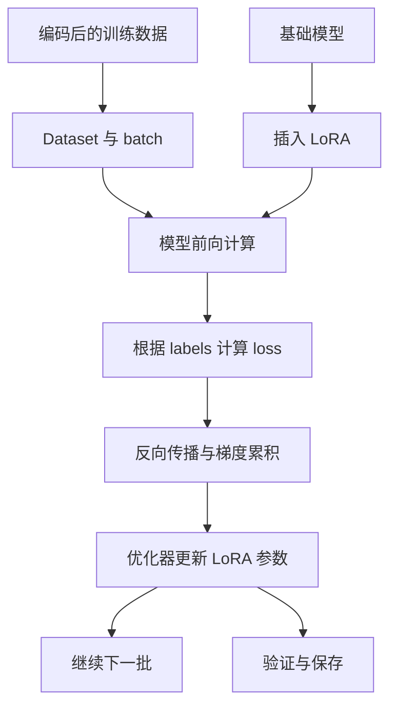

**006：LoRA SFT 训练入口与参数更新**

- 学习日期：2026-10-20。
- 主要代码：[train_lora_sft.py](D:/AgentProjects/shopping-grpo-longhorizon/scripts/train_lora_sft.py:338)。
- 学习位置：标签构造之后，训练后评测之前。
- 状态：代码阅读，尚未训练或合并模型。

**1．把上一节接到训练循环**

上一节得到了：

```python
{
    "input_ids": [...],
    "attention_mask": [...],
    "labels": [...],
}
```

这一节的链路是：



**这里是离线模仿学习。**训练入口不会让模型实时搜索或购买，也不会用任务 299 的 `0.18125` 直接计算 SFT loss。环境奖励此前用于轨迹验收；训练时学习的是成功轨迹中的 assistant 输出。

**2．先读 `main()` 的执行顺序**

| 阶段 | 关键函数或对象 | 目的 |
|---|---|---|
| 配置 | `parse_args()` | 读取模型、数据、输出与训练参数 |
| 数据检查 | `guard_blind_final()` | 防止最终测试任务误入训练 |
| 模板准备 | `_load_preprocessing_components()` | 加载 tokenizer、模板载体 |
| 编码 | `load_supervised_examples()` | 生成输入和 labels |
| 子集选择 | `select_training_examples()` | 选少量训练样本 |
| 模型加载 | `from_pretrained()` | 读取基础权重 |
| 适配器 | `get_peft_model()` | 插入 LoRA |
| 训练配置 | `TrainingArguments` | 设置更新、日志、验证与保存规则 |
| 执行 | `Trainer.train()` | 组织完整优化循环 |
| 保存 | `save_model()` 等 | 保存 adapter、模板和摘要 |

注意：子集选择发生在编码后，所以 `--train-count 8` 不代表只预处理文件中的八条数据。

**3．LoRA 到底更新什么？**

普通线性层可以写成：

```text
h = W × x
```

默认 LoRA 在旁边增加一个低秩更新：

```text
h = W_base × x + (alpha / r) × B × A × x
```

其中：

- `W_base`：基础模型权重，通常冻结。
- `A、B`：新增、可训练的较小矩阵。
- `r`：低秩维度，控制更新容量。
- `alpha/r`：适配器输出的缩放系数。

例如一个 `4096 × 4096` 的矩阵：

```text
原矩阵参数：4096 × 4096 = 16,777,216

r=16 时：
A、B 参数：16 × 4096 + 4096 × 16 = 131,072
```

这只是单层示例，不能当成整个模型的实际可训练比例。脚本调用：

```python
model.print_trainable_parameters()
```

用来检查实际情况。

**冻结基础权重不等于不计算基础模型。**它仍参与前向计算，梯度也需要经过相关运算到达适配器。因此 LoRA 节省了参数更新开销，但长上下文仍可能占用大量内存。

**4．本项目怎样添加 LoRA？**

核心代码是：

```python
model = get_peft_model(
    model,
    LoraConfig(
        task_type=TaskType.CAUSAL_LM,
        r=args.lora_r,
        lora_alpha=args.lora_alpha,
        lora_dropout=args.lora_dropout,
        bias="none",
        target_modules=list(args.target_modules),
    ),
)
```

| 参数 | 脚本默认值 | 理解重点 |
|---|---:|---|
| `lora_r` | 16 | 更新容量；增大不保证效果更好 |
| `lora_alpha` | 32 | 默认缩放为 `32/16=2`，不是学习率 |
| `lora_dropout` | 0.05 | LoRA 路径的训练正则化 |
| `target_modules` | 多种投影层 | 决定在哪些位置插入 LoRA |
| `bias` | `"none"` | 不额外训练基础层 bias |
| `task_type` | `CAUSAL_LM` | 因果语言建模任务 |

换模型时，需要核对模块名称。不能默认另一个架构也有完全相同的投影层。

**5．一次参数更新怎样发生？**

下面是概念流程，实际由 Trainer 和底层库组织：

```python
batch = ...                         # 取一批编码数据
outputs = model(**batch)             # 前向计算
loss = outputs.loss                 # 根据 labels 得到损失
loss.backward()                     # 计算梯度

# 到达梯度累积的更新时机：
optimizer.step()                    # 更新可训练参数
scheduler.step()                    # 调整学习率
optimizer.zero_grad()               # 清空梯度
```

不能直接把这段示意再套在 `Trainer.train()` 外面，否则会重复处理更新逻辑。

模型前向产生的 `logits` 可以理解为：

```text
[batch_size, sequence_length, vocabulary_size]
```

它表示各位置对词表的预测分数。优化内核可能避免实际保存完整 logits，所以这个形状用于理解，不是显存承诺。

模型内部进行 next-token 对齐，只对有效目标计算损失：

```text
此前用户需求、工具反馈和动作前缀
→ 预测下一个 assistant token
→ 与 labels 中的目标比较
→ 得到 loss
```

因此，工具反馈虽然 `labels=-100`，仍可以影响动作预测和参数学习。

**6．batch、梯度累积、epoch、step 要区分**

| 参数 | 含义 |
|---|---|
| `per_device_train_batch_size` | 每个设备每个 microbatch 的样本数 |
| `gradient_accumulation_steps` | 累积多少个 microbatch 后更新一次 |
| `epochs` | 遍历训练集多少轮 |
| `max_steps` | 优化器更新次数上限 |

数据并行下，有效样本 batch 大致为：

```text
每设备 batch × 梯度累积次数 × 数据并行进程数
```

例子：单卡、64 条样本、batch 为 1、累积 8 次：

```text
每次更新约使用 8 条样本
每个 epoch 约更新 64 / 8 = 8 次
两个 epoch 约更新 16 次
```

尾批不足时需要按实际处理。样本长度不同，也意味着相同样本数不等于相同监督 token 数。

**训练 `max_steps` 与 Agent 的动作步数没有直接关系。**本脚本中，正的训练 `max_steps` 会覆盖按 epoch 推出的训练长度。

**7．几个参数为什么影响训练？**

| 参数 | 作用 | 可能的问题 |
|---|---|---|
| `learning_rate` | 控制参数更新幅度 | 太大可能不稳定，太小学习缓慢 |
| `warmup_ratio` | 初期逐渐提高学习率 | 用于缓和训练初期更新 |
| `max_length` | 限制样本长度 | 太小丢掉长轨迹，太大增加内存 |
| `dtype` | 控制数值精度 | 与设备支持、内存和数值稳定性有关 |
| `gradient_checkpointing` | 重算部分前向以节省激活内存 | 增加计算耗时 |
| `qlora` | 以低比特加载基础权重 | 需要额外依赖与兼容支持 |

本项目 `dtype=auto` 在 CPU 上选 FP32，在 CUDA 上按支持情况选 BF16 或 FP16。

QLoRA 不意味着所有参数、梯度和计算都变成 4-bit。普通 LoRA 也不自动启用量化。

**8．验证 loss 与环境评测有什么不同？**

训练脚本有有效验证样本时，按 epoch 进行验证。

验证时：

```text
验证轨迹 → 同样的编码和 labels → 前向 → eval_loss
```

它不执行优化器更新，也不进入购物环境。

| 信号 | 能说明什么 |
|---|---|
| 训练 loss 下降 | 对训练动作的预测更贴合 |
| 验证 loss 下降 | 对留出轨迹的预测更贴合 |
| 环境任务成功率提升 | 实际交互能力改善 |

训练 loss 下降也可能来自记忆。**SFT 是否让 Agent 更会购物，仍需接回环境评测。**

脚本最终打印的 `result.metrics` 可能没有 `eval_loss`，还需要查看 `log_history` 中的验证记录，不能仅凭 `N/A` 断言没有验证。

**9．训练完成后保存什么？**

主要产物：

```text
adapter 权重与配置
tokenizer / processor 相关文件
train_summary.json
按训练策略保存的 checkpoint
```

需要区分：

- **Adapter**：部署时通常还需要匹配的基础模型。
- **Checkpoint**：可包含优化器、调度器和训练状态，用于恢复训练。
- **Merged model**：基础权重与 LoRA 合并后的独立完整模型。

合并由 [merge_lora_adapter.py](D:/AgentProjects/shopping-grpo-longhorizon/scripts/merge_lora_adapter.py) 完成：

```text
匹配的基础模型 + SFT adapter
→ merge_and_unload()
→ 完整模型
→ 模型服务
→ 环境评测
```

合并不执行新训练，也不自动证明模型效果正确。

当前课程训练是 A → B → C：每阶段先训练 adapter，再合并，下一阶段从合并模型开始。课程启动器设置每阶段 1 epoch，覆盖训练脚本默认的 3 epoch。因此应以最终命令参数为准。

**10．今天最值得思考的问题**

1. 基础权重冻结，为什么仍需要较多内存？
2. `alpha/r` 与学习率分别改变什么？
3. 为什么 SFT 不实时调用商店，却能学习工具策略？
4. 为什么训练 loss 降低不保证成功率提高？
5. 为什么不能用这个脚本更新 DeepSeek API 的权重？
6. 为什么只加载最终 adapter，不等于精确恢复训练？

第五题的关键是：这个入口需要**可本地加载的模型权重**。你此前调用的 DeepSeek API 可以作为 Actor 或教师，不能直接通过此脚本更新服务商模型。

下一步建议学习“验证、checkpoint 与模型合并”，随后具备小模型和依赖时，再进行少样本、少更新的实际 SFT。当前先把**数据 → loss → 梯度 → LoRA 参数 → 保存模型**这条线讲清楚。

---

索引可追加：

```markdown
| 006 | [LoRA SFT 训练入口](006-lora-sft-training.md) | 已阅读参数更新、验证与保存；尚未启动训练 |
```