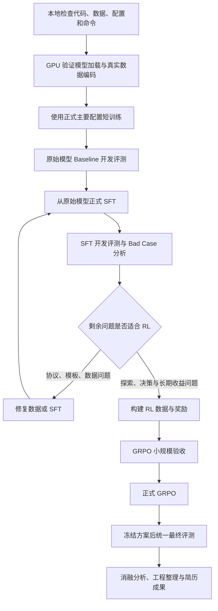

# 项目训练与验证全链路计划

> 日期：2026-10-21  
> 目标：完成可复现的 Base → SFT → GRPO 对比，形成有数据处理、实验依据和效果验证的项目。  
> 本文是执行计划；“待验收”不代表已经运行通过。

## 一、总体链路

Baseline 可以在短训练之前执行，但必须使用原始模型，并固定评测协议。

---

## 二、数据与实验边界

| 数据用途 | 使用方式 | 禁止事项 |
|---|---|---|
| SFT 训练 | Pure V4 中课程清单指定的 1073 条轨迹 | 混入开发集、最终测试集 |
| SFT 验证 | 清单指定的 119 条轨迹，计算验证 loss | 参与梯度更新 |
| Agent 开发评测 | 独立任务集，运行真实环境并评价任务完成情况 | 与训练任务混用后仍声称独立验证 |
| RL 训练与验证 | 单独审查任务划分 | 污染全局开发集和最终测试集 |
| 最终评测 | 固定 200 题，方案冻结后统一比较 | 用于选择奖励、提示词和 checkpoint |

注意：

1. SFT 验证 loss 与 Agent 任务成功率不是同一个指标。
2. 此前发现 SFT 验证集中的任务 `7682、14953` 出现在 GRPO 训练集中，正式 RL 前必须处理全局划分。
3. 最终 200 题此前未发现与训练数据重叠。
4. DeepSeek API 可以作为开发参考或教师模型，但不能替代同源原始模型的 Base 对照。
5. 所有阶段记录代码提交、模型 revision、数据哈希、随机种子和配置。

---

## 三、阶段 0：本地预检查

### 目标

在租卡之前发现能够通过 CPU、静态分析和数据检查发现的问题。

### 工作内容

- 检查代码语法、CLI 参数和 CPU smoke。
- 检查 JSONL 可解析性、重复任务和字段完整性。
- 检查工具调用与工具返回是否对齐。
- 检查训练、验证、最终测试任务交集。
- 校验商品文件、搜索数据库和冻结数据哈希。
- 执行课程启动器 dry-run，检查训练与合并命令。
- 保留本地修改补丁，防止服务器重新 clone 后遗漏修复。

### 当前已知结果

| 项目 | 当前状态 |
|---|---|
| Python 语法 | 128 个已跟踪文件通过 |
| CPU smoke | 5 项通过 |
| SFT 数据处理检查 | 6 项通过，使用模拟 tokenizer |
| 入口与课程检查 | 13 项中 12 项通过 |
| 课程测试失败 | Windows 路径分隔符断言问题 |
| Pure V4 数据 | 1192 条；1073 训练、119 验证 |
| 商品与索引 | 商品 SHA256、SQLite 完整性检查通过 |
| 真实模型加载 | 尚未验证 |
| 真实 tokenizer 编码 | 尚未验证 |
| GPU 训练 | 尚未验证 |

### 必须处理的问题

1. 三份数据文件存在 CRLF 换行导致的哈希差异，恢复 LF 后与冻结内容一致。
2. 不修改数据清单哈希来绕过校验。
3. `web_agent_text_env.py` 与冻结环境清单不一致，需在 GRPO 前审查；单纯恢复 LF 无法解决。
4. Windows 路径断言需要兼容修复。

### 通过条件

- 数据哈希符合约定。
- 课程 dry-run 成功。
- 数据划分清晰。
- 没有影响 SFT 启动的已知代码问题。

### 产物

检查报告、问题列表、数据划分记录、代码版本与补丁、训练参数表。

---

## 四、阶段 1：GPU 上验证模型与训练数据

### 目标

证明真实模型、真实模板、真实数据可以正确连接。

### 工作内容

1. 创建独立 Linux 环境。
2. 按仓库要求安装固定版本依赖。
3. 检查 GPU、CUDA、RAM、磁盘空间。
4. 下载原始模型，记录实际 revision。
5. 加载 config、processor/tokenizer 和模型。
6. 注入 LoRA，核对目标模块和可训练参数。
7. 使用真实 `chat_template` 与 `tools` 编码训练数据。
8. 统计编码长度、超长丢弃数量和有效监督 token。
9. 人工解码检查若干样本。

### 样本检查重点

- assistant 工具调用参数是否完整。
- user 和 tool 消息是否保留为上下文。
- 非监督位置的 labels 是否为 `-100`。
- assistant 是否存在有效监督标签。
- 终止决策是否仍在保留样本中。
- 训练和验证是否按课程清单正确筛选。

### 配置原则

优先验证仓库默认模型 `Qwen/Qwen3.5-2B`，避免同时修改模型、模板、长度和训练方法。

参考主要配置：

| 参数 | 参考值 |
|---|---|
| 精度 | BF16 |
| 最大序列长度 | 24576 |
| 单卡 batch | 1 |
| 梯度累积 | 8 |
| LoRA rank / alpha | 16 / 32 |
| LoRA dropout | 0.05 |
| 梯度检查点 | 开启 |
| 注意力实现 | SDPA |

显存需求以实测为准。长轨迹的激活、logits 和训练实现都会影响峰值，不能只按模型参数量估算。

### 通过条件

模型加载成功；LoRA 参数符合预期；真实编码正确；数据丢弃情况可解释。

### 产物

环境版本记录、模型 revision、编码统计、解码样例、可训练参数统计。

---

## 五、阶段 2：正式主要配置短训练

### 目标

在正式训练前验证前向、反向、保存和重载。

### 执行原则

- 使用独立输出目录：`outputs/models/preflight-sft`。
- 使用正式主要参数，不随意降低长度掩盖显存问题。
- 先运行 3 个 optimizer steps。
- 梯度累积为 8 时，通常对应 24 个 micro-batches。
- 另行验证接近最大长度的保留样本，三步训练无法覆盖全部长度。
- 检查验证前向传播，不只检查训练前向。

### 验收条件

- loss 有限，无 NaN/Inf。
- 反向传播和参数更新成功。
- 可训练参数符合 LoRA 预期。
- 记录显存峰值和单步时间。
- adapter 保存和重载成功。
- 合并成功，合并模型可以启动。
- 少量开发任务可以完成模型服务与环境服务的交互。

### 停止条件

出现以下情况时，不开始正式训练：

- OOM。
- 标签全部为 `-100`。
- 大量样本被异常丢弃。
- 模板与模型不匹配。
- loss 异常。
- 保存或重载失败。

### 重要区别

`max_steps=3` 会改变学习率调度总步数。

因此，短训练验证工程可运行性，不能证明训练收益，也不代表与正式训练具有完全相同的学习率轨迹。

---

## 六、阶段 3：同源原始模型 Baseline

### 目标

为后续 SFT 和 GRPO 提供可比较的起点。

### 工作内容

1. 使用正式 SFT 对应的原始模型和 revision。
2. 固定开发任务列表。
3. 固定环境、工具协议和提示词。
4. 固定 temperature、max_tokens、max_steps。
5. 先跑少量任务，再运行预定开发集。
6. 保存轨迹、summary、配置和异常日志。

### 指标

- 严格成功率。
- 购买成功率。
- 奖励有效率。
- 平均终局奖励。
- 平均执行步数。
- 工具拒绝率。
- token 消耗、耗时及推理成本。

注意：`done` 表示终止，不等于严格成功。

### 产物

Base 开发集结果、完整轨迹、配置与 Bad Case 初始分类。

---

## 七、阶段 4：从原始模型正式 SFT

### 原则

短训练通过后：

- 重新加载原始模型。
- 不 resume 冒烟检查 checkpoint。
- 使用新的正式输出目录。
- 固定数据、参数和随机种子。

### 课程链路

| 阶段 | 起点 | 训练条数 | 学习率 | Epoch |
|---|---|---:|---:|---:|
| A | 原始模型 | 256 | 1e-4 | 1 |
| B | A 的 merged 模型 | 799 | 7e-5 | 1 |
| C | B 的 merged 模型 | 1073 | 5e-5 | 1 |

每阶段训练新 LoRA，然后合并。

“从原始模型正式开始”指阶段 A；B、C 继承前一阶段，是课程训练设计。

### 每阶段保存

- adapter。
- merged 模型。
- 训练和验证 loss。
- 编码保留与丢弃统计。
- 显存峰值、耗时。
- 完整训练配置。

### 通过条件

模型可重载，训练记录完整，开发表现没有明显协议退化。

---

## 八、阶段 5：SFT 开发评测与 Bad Case

### 目标

回答：SFT 改善了什么，仍然失败在哪里？

在与 Base 相同的开发任务和推理配置下评测 SFT。

| 错误类型 | 重点分析 | 优先处理 |
|---|---|---|
| 工具协议错误 | 名称、参数、调用顺序 | 模板、清洗、SFT |
| 未核验就购买 | 属性、规格、选项证据不足 | 补充核验轨迹 |
| 搜索策略弱 | 查询无效、候选不足 | 数据与搜索策略 |
| 重复循环 | 无信息增益的动作 | 终止机制、奖励 |
| 终止不合理 | 过早购买、放弃、超步数 | 决策数据与 RL |
| 环境异常 | 状态、工具、奖励不可信 | 先修基础设施 |

### 必须回答的问题

1. SFT 是否提高了成功率，还是仅减少格式错误？
2. 哪些错误通过补数据即可改善？
3. 哪些错误涉及探索与长期收益，值得使用 RL？
4. 成功率提升是否伴随成本明显增加？

### 产物

逐任务对比、错误分类、代表轨迹、下一步可验证的优化假设。

---

## 九、阶段 6：RL 数据与奖励设计

### 目标

把剩余问题转化为可验证的学习信号。

### 工作内容

1. 审查 RL 训练、验证与全局开发集的交集。
2. 解决已发现的跨阶段数据重叠。
3. 审查并解决冻结环境源码与清单不一致。
4. 选择结果可验证、存在探索空间的任务。
5. 从正式 SFT 模型生成同任务多条轨迹。
6. 检查组内奖励差异、全对和全错比例。
7. 检查超时、环境异常和无效奖励。
8. 每项奖励改动对应一个明确 Bad Case。

### 奖励设计原则

- 保留原环境奖励作为对照。
- 新增核验、效率或偏好奖励时做消融。
- 不把新奖励数值上升直接解释为能力上升。
- 检查是否出现刷奖励、过早终止或过度保守。
- 最终能力继续用固定外部指标评价。

### 通过条件

奖励可复算，环境一致，数据边界清晰，组内具有有效学习信号。

### 产物

RL 数据清单、奖励说明、奖励分布、典型轨迹和消融方案。

---

## 十、阶段 7：GRPO 验收与正式训练

### 先做小规模验收

1. 单任务环境交互。
2. 同任务多候选采样。
3. 奖励计算与分组检查。
4. 少量 GRPO 更新。
5. checkpoint 保存与重载。
6. 开发集评测。

### 检查重点

- 工具观察不参与策略 loss。
- 奖励正确归属对应轨迹。
- 同组样本来自相同任务。
- 超时能释放环境资源。
- KL、熵、生成长度和梯度可监控。
- 没有明显奖励投机。

### 正式训练

验收通过后，从正式 SFT 起点重新开始正式 GRPO，使用独立输出目录。

并行度、候选数量和上下文长度依据实测确定。单卡 96GB 不代表任意配置都能运行。

---

## 十一、阶段 8：最终统一对比

方案与模型选择冻结后，在相同最终 200 题上比较：

| 模型 | 验证目的 |
|---|---|
| Base | 原始能力 |
| SFT | 监督微调收益 |
| SFT + 原奖励 GRPO | RL 收益 |
| SFT + 改进奖励 GRPO | 奖励改进收益 |

统一：

- 环境和工具版本。
- 提示词与上下文预算。
- 最大动作步数。
- 推理参数。
- 指标定义。

报告成功率、执行成本、失败类型及逐任务配对差异。有随机采样时，报告重复运行波动。

---

## 十二、项目成果与简历材料

最终整理：

1. 数据筛选、清洗和轨迹验收流程。
2. 真实模板与 assistant-only 标签构造。
3. 可复现的 SFT、合并和模型服务流程。
4. Base → SFT → GRPO 对比。
5. Bad Case 驱动的奖励改进。
6. 消融实验与资源成本。
7. 可运行命令、配置和实验记录。

简历只写实际测得的结果，不提前填写提升比例。

---

## 十三、近期任务清单

- [ ] 修复 LF 并重新运行课程 dry-run。
- [ ] 处理 Windows 路径断言。
- [ ] 固定代码、模型 revision 和数据划分。
- [ ] GPU 验证真实模型、模板和 LoRA。
- [ ] 统计真实 token 长度与丢弃情况。
- [ ] 正式主要配置短训与长样本验收。
- [ ] 验证保存、重载、合并和服务。
- [ ] 完成同源 Base 开发评测。
- [ ] 从原始模型正式执行 A → B → C。
- [ ] SFT 开发评测与 Bad Case 分析。
- [ ] 解决环境冻结与跨阶段划分问题。
- [ ] RL 数据、奖励与 GRPO 验收。
- [ ] 正式 GRPO。
- [ ] 冻结方案，最终统一评测。
- [ ] 整理工程与简历成果。